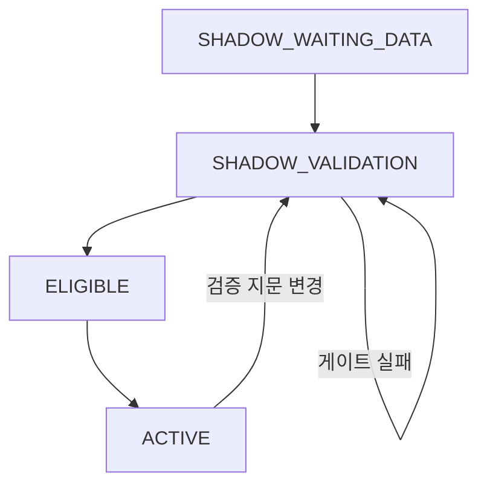

# 유동성 위험 모듈 — 격리·검증·승격 구조

이 디렉터리는 대한민국 거시 유동성 점수를 다른 위험축과 분리해 개발하기 위한 독립 모듈입니다. 기본 상태는 `SHADOW`이며, 이 상태의 계산값은 `risk-data/liquidity/summary.json`에만 남고 6대 위험 신호의 종합점수에는 들어가지 않습니다.

## 산식

| 구성요소 | 가중치 | 원자료 | 계산 |
|---|---:|---|---|
| Marshall K 갭 | 50% | ECOS M2, 명목 GDP | 분기 평균 M2 ÷ 연율화 명목 GDP의 one-sided HP 갭과 expanding 백분위 |
| 실질 M2 갭 | 30% | ECOS M2, CPI | M2 ÷ CPI의 월별 one-sided HP 갭과 expanding 백분위 |
| 유동성 확산도 | 20% | ECOS M2, Lf, L, CPI | 세 실질 유동성지표 전년비 증가율의 expanding 백분위 평균 |

월별 HP λ는 Ravn–Uhlig의 빈도 변환에 따라 `129,600`, 분기 λ는 `1,600`을 사용합니다. 모든 역사점수는 해당 시점까지의 자료만 쓰며, 미래 관측치를 붙여도 과거점수가 바뀌지 않는지 테스트합니다.

가계신용·DSR은 기존 `신용취약성` 축과 중복되므로 유동성 산식에 넣지 않습니다. M2 하나만으로 상황을 단정하지 않도록 Lf·L 확산도를 별도 구성요소로 둡니다.

## 파일 경계

```text
risk-monitor/liquidity/config.json             ECOS 계열코드·가중치·검증 기준
risk-monitor/liquidity/model.py                부작용 없는 순수 계산
risk-monitor/liquidity/update_liquidity.py     ECOS 증분수집·수정이력·검증 산출
risk-monitor/liquidity/adapter.py              본체로 가는 fail-closed 읽기 전용 경계
risk-monitor/liquidity/promotion.json          최종 승격 스위치와 승인 지문
risk-monitor/liquidity/tests/                  no-lookahead·격리계약 단위테스트
risk-data/liquidity/raw.csv                    ECOS 공식 관측치 캐시
risk-data/liquidity/revision_history.csv       공식 수정치 이력
risk-data/liquidity/score_vintages.csv         끝점 점수 빈티지
risk-data/liquidity/validation.json             기계 검증 게이트
risk-data/liquidity/backtest.json               백테스트·빈티지·사람검토 게이트
risk-data/liquidity/summary.json                모듈 공개 계약
```

## 상태 전이



- `SHADOW_WAITING_DATA`: ECOS 캐시가 없거나 필수계열이 빠짐
- `SHADOW_VALIDATION`: 그림자 점수는 계산되지만 하나 이상의 검증 게이트가 미통과
- `ELIGIBLE`: 9개 게이트가 모두 `PASS`지만 명시적 승인이 없음
- `ACTIVE`: 전부 통과한 `validationFingerprint`가 `promotion.json`의 승인 지문과 일치하고 `enabled=true`

본체의 `adapter.py`가 위 계약을 다시 검사합니다. 파일에 높은 점수를 임의로 써도 `ACTIVE + 전체 PASS + 지문 일치`가 아니면 본체에는 `score=null`과 빈 이력만 전달됩니다.

## 검증 게이트

자동 게이트 6개는 공식계열 신원, 표본길이, 연속성, 발표시차, 계산 무결성, no-lookahead입니다. 최종 승격에는 다음 수동·증거 게이트 3개도 필요합니다.

1. `predictiveBacktest`: 전국 실질주택가격의 4·8분기 선행성과와 오경보를 expanding-window로 확인
2. `revisionStability`: 최소 6개 빈티지에서 끝점 점수·등급 변경 폭 확인
3. `humanReview`: 신용축과의 중복, 위기구간·비위기구간 오경보, 산식 해석을 승인자가 검토

백테스트 기준과 결과를 `risk-data/liquidity/backtest.json`에 기록하고 세 항목을 `PASS`로 바꾼 뒤 다시 계산합니다. 생성된 `validationFingerprint`를 그대로 `promotion.json`에 복사하고 승인자·승인시각을 기록한 다음에만 `enabled`를 켭니다. 설정·자료·코드·검증결과가 바뀌면 지문이 달라져 자동으로 SHADOW로 복귀합니다.

## 실행

```bash
export ECOS_API_KEY="발급받은_키"
python risk-monitor/liquidity/update_liquidity.py
python -m unittest discover -s risk-monitor/liquidity/tests -p 'test_*.py' -v
python risk-monitor/update_risk_data.py --rebuild-only
```

API 키는 GitHub Actions의 `ECOS_API_KEY` secret에만 저장합니다. 키가 없거나 ECOS가 일시 실패하면 기존 공식 캐시를 유지하며, 새 점수를 활성화하지 않습니다.

